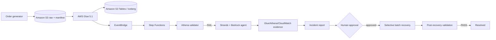

# AWS Data Reliability Copilot

AWS Data Reliability Copilot is a production-inspired AWS sample for detecting and safely recovering
from silent batch data defects. It addresses the case where an AWS Glue job reports `SUCCEEDED` but
its output is missing, duplicated, stale, schema-incompatible, or otherwise inconsistent.

Deterministic code decides whether data is correct. A Strands agent on Amazon Bedrock investigates the
evidence and recommends a response; it cannot approve or execute recovery.

## Architecture



See [architecture.md](docs/architecture.md) for the detailed sequence and trust boundaries.

## AWS services

- Amazon S3 for raw batches, manifests, reports, and query results
- Amazon S3 Tables for the curated Apache Iceberg `orders` table
- AWS Glue 5.1 for primary and recovery PySpark ETL
- AWS Glue Data Catalog `s3tablescatalog` integration
- Amazon Athena for deterministic reconciliation
- Amazon EventBridge and AWS Step Functions for orchestration
- AWS Lambda for bounded validation, planning, approval, and agent handlers
- Amazon Bedrock and Strands Agents for evidence-grounded investigation
- Amazon CloudWatch for operational evidence and retained logs
- AWS CDK v2 for infrastructure

## Reliability rules

Validation is independent of the LLM and always scoped to one `batch_id`:

1. Independent manifest row count
2. Source and target row counts
3. Distinct business-key counts
4. Missing source business keys
5. Unexpected target business keys
6. Duplicate target business keys
7. Required-field nullability
8. Schema compatibility
9. Freshness SLA

Athena failures return `ERROR`; they are never misreported as a passing or failing data-quality rule.
The raw Glue table uses injected partition projection so the required `batch_id` equality predicate
selects only that raw prefix rather than scanning every uploaded batch.

## Data model

The required columns are lowercase:

```text
order_id, customer_id, order_timestamp, order_amount, status, batch_id
```

Glue adds `ingestion_timestamp`, `source_file`, `processing_timestamp`, and `pipeline_run_id`. The
generator is reproducible for a supplied seed, and the expected-result manifest is created before any
failure is injected.

## Failure scenarios

| Scenario | Behavior | Expected result |
|---|---|---|
| `healthy` | Every row is processed once | Validation `PASS`; no incident |
| `missing_records` | Glue silently filters a deterministic subset | Glue succeeds; missing keys fail |
| `duplicate_records` | Glue duplicates a deterministic subset | Glue succeeds; duplicate keys fail |

The deployed demo intentionally focuses on those three reproducible silent-success paths. The local
injector also provides `schema_drift` to test the Glue required-field guard, and the validator has a
`stale_batch` freshness contract. A source-schema rejection fails Glue before the success-triggered
workflow starts; a truly absent stale batch requires a scheduler to emit a deadline event. Neither is
presented as a deployed end-to-end scenario.

Scenario definitions are under [`scenarios/`](scenarios/).

## Prerequisites and supported runtimes

- Python 3.11+ locally; Lambda uses Python 3.14
- AWS CDK CLI v2.1146.1 or later, a CDK-supported Node.js release, `uv`, and AWS CLI v2
- AWS Glue 5.1 with its native Apache Iceberg runtime
- A tool-capable Bedrock model or inference profile
- A Region supporting all selected services

Region and runtime availability changes. Verify the current official
[S3 Tables integration Regions](https://docs.aws.amazon.com/AmazonS3/latest/userguide/s3-tables-integration-overview.html)
and [Glue/S3 Tables requirements](https://docs.aws.amazon.com/AmazonS3/latest/userguide/s3-tables-integrating-glue.html)
before deployment.

## Quick start

```bash
cd samples/agentic-batch-data-reliability
uv sync --dev
uv pip install -r infrastructure/requirements-dev.txt
make test
make lint
make synth
```

Set an exact Bedrock ID and ARN, then deploy:

```bash
export BEDROCK_MODEL_ID='<tool-capable-model-or-inference-profile-id>'
export BEDROCK_MODEL_ARN='<exact-model-or-inference-profile-arn>'
make deploy STAGE=dev AWS_REGION=us-east-1
```

Run the mandatory scenarios:

```bash
SCENARIO=healthy make demo STAGE=dev AWS_REGION=us-east-1
SCENARIO=missing_records make demo STAGE=dev AWS_REGION=us-east-1
SCENARIO=duplicate_records make demo STAGE=dev AWS_REGION=us-east-1
```

Detailed commands and verification steps are in [deployment.md](docs/deployment.md) and
[demo.md](docs/demo.md).

## Agent and MCP design

The investigation agent uses Pydantic-backed Strands structured output. It separates observed facts,
hypotheses, evidence references, limitations, and recommendations. Model ID, Region, turns, and output
tokens are configurable.

For local/container investigation, the agent starts the official AWS Labs Data Processing and
CloudWatch MCP servers through `uvx`. Only reviewed tools are exposed, and both servers retain their
default read-only behavior. The reviewed package releases are pinned in code; operators can override
the exact specs with `AWS_DATA_PROCESSING_MCP_SPEC` and `AWS_CLOUDWATCH_MCP_SPEC` only after reviewing
new tool contracts. The Lambda runtime cannot host `uvx` stdio subprocesses, so the deployed agent
uses a bounded read-only adapter for the same Glue, Athena, and CloudWatch evidence APIs. This runtime
distinction is documented rather than pretending that an arbitrary stdio server is remotely hosted.

## Recovery safety

- The agent role cannot write S3 Tables, start Glue jobs, or approve workflows.
- A human must submit a Step Functions task-token callback within 24 hours.
- The callback output retains the exact proposed incident and batch scope.
- Deterministic code validates the approved scope again.
- A separate recovery Glue job runs healthy transformation logic.
- Iceberg `overwritePartitions()` replaces only the `batch_id` partition in one commit.
- Same-batch retries are idempotent; unrelated batches are not selected.
- The incident resolves only when post-recovery deterministic validation returns `PASS`.

The sample does not claim exactly-once processing across arbitrary concurrent writers. See the
concurrency limitation in [architecture.md](docs/architecture.md).

## Expected output

Validation reports use `PASS`, `FAIL`, `ERROR`, and `SKIPPED`. A locally produced example is in
[`examples/incident_reports/`](examples/incident_reports/). It is explicitly identified as local test
output and contains no fabricated AWS identifiers or logs.

## Testing

```bash
make test
make lint
make synth
```

The repository separates unit, AWS integration, and end-to-end tests. Tests marked `integration` or
`e2e` require a deployed account and are not presented as passing merely because the source exists.
The full deployed checklist is in [demo.md](docs/demo.md). The small structured-report evaluation
dataset and rubric are documented in [evaluation.md](docs/evaluation.md).

## Security

Data and logs are untrusted agent inputs. Tool responses are bounded; prompts prohibit following
retrieved instructions; MCP servers are read-only; execution data is excluded from Step Functions
logs; and approval/recovery fields are schema-constrained. These are defense-in-depth controls—the
deterministic approval and recovery boundaries remain authoritative.

See [security.md](docs/security.md) for IAM exceptions, prompt-injection handling, and production
adaptations.

## Cost

There is no continuously running compute. Glue, Athena scans, S3/S3 Tables, Bedrock tokens, Lambda,
Step Functions, the Glue Data Catalog, and CloudWatch can incur charges. Defaults use small data,
bounded scans/agent turns, short log retention, and FLEX Glue jobs. See [cost.md](docs/cost.md).

## Cleanup

```bash
make destroy STAGE=dev AWS_REGION=us-east-1
```

Cleanup intentionally retains the regional `s3tablescatalog` because it is shared account state and
may have existed before this sample. See [cleanup.md](docs/cleanup.md).

## Troubleshooting

See [troubleshooting.md](docs/troubleshooting.md) for catalog, Glue, Athena, EventBridge, Bedrock,
MCP, and approval diagnostics.

## Known limitations

- Full end-to-end behavior requires AWS credentials, service availability, and deployment testing.
- The Lambda agent uses a direct bounded evidence adapter; AWS Labs MCP subprocesses are demonstrated
  in the local/container runtime.
- The sample has no external per-batch lock for multiple concurrent schedulers.
- The included approval experience is an operator CLI, not a production user interface.
- Stale-batch scheduling is modeled by the validator contract; production schedulers should emit an
  explicit deadline event for batches that never start Glue.

## Project documentation

- [Implementation plan](docs/implementation-plan.md)
- [Architecture](docs/architecture.md)
- [Naming conventions](docs/naming-conventions.md)
- [Deployment](docs/deployment.md)
- [Demo](docs/demo.md)
- [Agent evaluation](docs/evaluation.md)
- [Security](docs/security.md)
- [Cost](docs/cost.md)
- [Troubleshooting](docs/troubleshooting.md)
- [Cleanup](docs/cleanup.md)
- [Contribution proposal](docs/contribution-proposal.md)

## License

This sample is licensed under the repository's [MIT-0 license](../../LICENSE).
