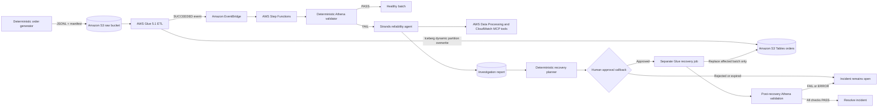

# Architecture

## Design



## Trust boundaries

- The validator—not the model—decides whether data is reliable.
- The agent receives read-only evidence and can only recommend recovery.
- A task-token callback is the authorization boundary. The approval object is encrypted in S3 and
  should be readable only by designated operators.
- The recovery handler revalidates incident and batch identifiers before constructing job arguments.
- The Glue writer uses Iceberg `overwritePartitions()` against a table partitioned by `batch_id`.
  A same-batch retry replaces that partition in one Iceberg commit and cannot overwrite other batches.
- Post-recovery validation is independent of the agent and controls final resolution.

## Catalog hierarchy

```text
s3tablescatalog
└── abdr-<stage>-curated        # table-bucket child catalog
    └── order_processing        # namespace/database
        └── orders              # Iceberg table
```

The `s3tablescatalog` parent is shared account/Region state. The deployment helper creates it only
when missing and cleanup intentionally retains it.

## Event and state sequence

1. The demo uploads raw JSONL and its independent manifest.
2. The primary Glue job processes one `batch_id`; injected missing/duplicate scenarios still succeed.
3. EventBridge starts a Standard workflow execution from the Glue success event.
4. Validation retrieves the Glue arguments, scopes every Athena query to the batch, and persists JSON.
5. `PASS` ends healthy. `ERROR` ends as an infrastructure failure. `FAIL` atomically claims a stable
   incident ID in S3; a repeated delivery for that Glue run ends at `DuplicateEventIgnored`.
6. Strands retrieves validation, Glue, Athena, and CloudWatch evidence and writes structured findings.
7. Deterministic code creates a batch-only proposal.
8. Step Functions waits up to 24 hours for a human callback.
9. Approval starts a distinct recovery Glue job and waits for it to finish.
10. A new validation ID is produced for recovery verification. Only `PASS` resolves the incident.

## Known concurrency limitation

Iceberg optimistic concurrency protects table metadata commits, but the sample does not implement an
external per-batch lock. Concurrent writers for the same `batch_id` can race; one may fail and retry,
or the later valid commit may replace the earlier partition. Production adoption should add explicit
batch ownership when multiple schedulers can submit the same batch concurrently.
